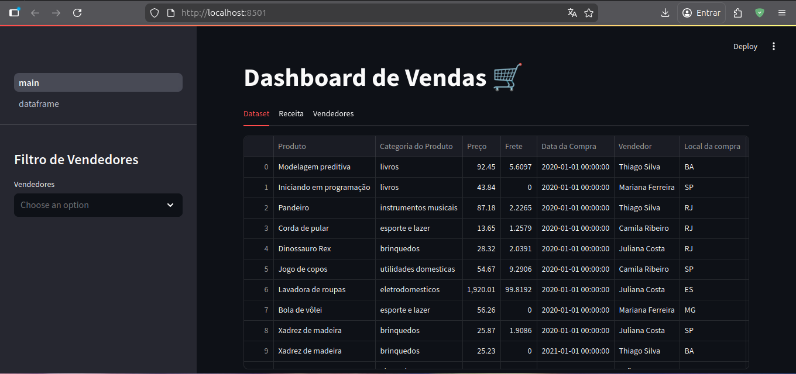
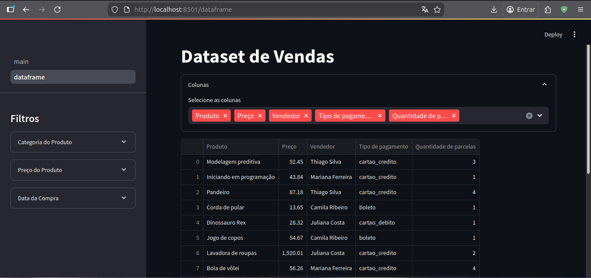

# Sales Dashboard 🛒

This project is a Sales Dashboard built with Python and Streamlit. It provides a visual and interactive way to analyze sales data, including revenue by state, monthly revenue, revenue by category, and seller performance.

## 🚀 Technologies Used

This project utilizes the following technologies and libraries:

- **[Python](https://www.python.org/)**: The core programming language.
- **[Streamlit](https://streamlit.io/)**: For creating the interactive web application.
- **[Pandas](https://pandas.pydata.org/)**: For data manipulation and analysis.
- **[Plotly](https://plotly.com/python/)**: For generating interactive charts and graphs.
- **[Altair](https://altair-viz.github.io/)**: For declarative statistical visualization.

## 📁 Project Structure

The project structure is organized as follows:

```text
.
├── data
│   └── vendas.json
├── dataset.py
├── graphs.py
├── main.py
├── pages
│   └── Resumo.py
├── requirements.txt
├── utils.py
└── .gitignore
```

> [!NOTE]
> The `.github` folder is used for repository configuration and preview images, and is not shown in the tree above.

## 🛠️ How to Run the Project

### 1. Create a Virtual Environment

It is recommended to use a virtual environment to manage dependencies.

```bash
# Create the virtual environment
python3 -m venv .venv

# Activate the virtual environment
# On Linux/macOS:
source .venv/bin/activate
# On Windows:
.venv\Scripts\activate
```

### 2. Install Dependencies

Install the required libraries listed in `requirements.txt`:

```bash
pip install -r requirements.txt
```

### 3. Execute the Application

To start the dashboard, use the following command:

```bash
streamlit run main.py
```

## 🖥️ Non-versioned Folders

The following folders/files are not versioned (ignored by Git) for security and performance reasons:

- `.venv/`: Contains the local Python environment and installed libraries.
- `__pycache__/`: Contains compiled Python files for faster execution.

## 📷 Previews



